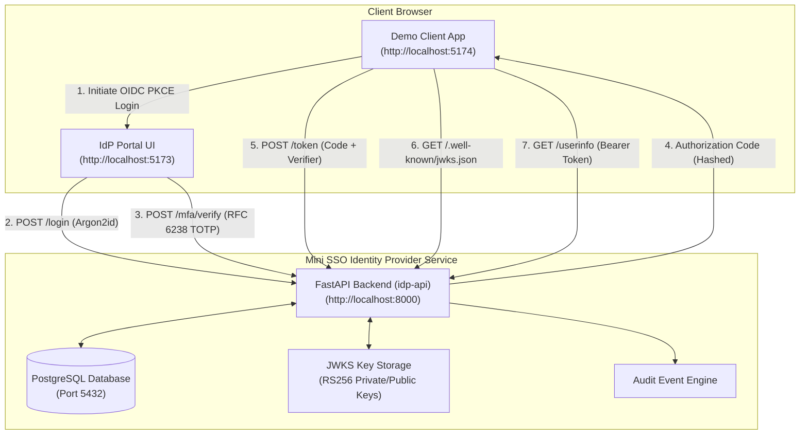
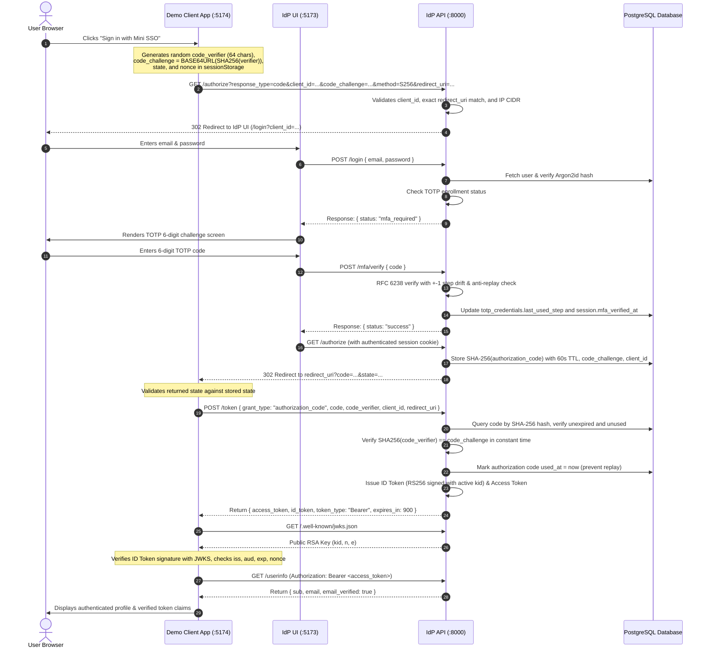

# Mini SSO Login Service

[](https://github.com/devanshisingal/mini-sso/actions/workflows/ci.yml)

A lightweight OpenID Connect (OIDC) Identity Provider and Single Sign-On (SSO) service with Time-Based One-Time Password (TOTP) two-factor authentication (2FA), paired with a React relying party demonstration application. Built to practice core engineering competencies emphasized in the HENNGE Full-Stack Pathway: API design, cryptographic primitives and authentication security basics, front-end state management, testing discipline, containerized workflows, and cloud deployment. Start the entire system—PostgreSQL database, FastAPI identity provider, React IdP portal, and React demo client—with a single command: `docker compose up --build`.

> [!NOTE]
> **Educational Project Notice**: This is an educational implementation developed to explore authentication, authorization, and security fundamentals. It implements a subset of OpenID Connect and is not production-ready or certified.

---

## What It Implements

This project implements a robust, spec-compliant subset of OpenID Connect Core 1.0 and OAuth 2.0:
- **Authorization Code Flow with PKCE (S256 only)**
- **Discovery Endpoint**: `GET /.well-known/openid-configuration`
- **Multi-Key JWKS Endpoint**: `GET /.well-known/jwks.json` supporting active and retired keys
- **UserInfo Endpoint**: `GET /userinfo` (Bearer token authentication)
- **Second-Factor TOTP**: RFC 6238 implementation from scratch using standard library `hmac` and `hashlib` with dynamic truncation, clock drift tolerance ($\pm 1$ step), and anti-replay protection.
- **Backup Recovery Codes**: 10 single-use emergency recovery codes generated upon 2FA enrollment.
- **Tamper-Evident Audit Trail**: Cryptographic SHA-256 hash-chained audit log with integrity verification (`GET /admin/audit-log/verify`).
- **Signing Key Rotation**: Dynamic active key rollover without downtime or in-flight token invalidation (`POST /admin/keys/rotate`).
- **Maintenance Sweeps**: Background or on-demand purging of expired authorization codes and stale sessions (`POST /admin/maintenance/cleanup`).
- **Request Tracing & Structured Logging**: `X-Request-ID` correlation middleware and latency metrics.

### What Is Not Supported (By Design)
- Implicit Flow and Hybrid Flow (deprecated by OAuth 2.1 / BCP for security)
- Client Secrets for public clients (PKCE is strictly enforced instead)
- Dynamic Client Registration (RFC 7591)
- User Consent Screen (designed for first-party enterprise SSO where access is pre-granted)
- Account Recovery / Password Reset via email

---

## Architecture Overview

The system consists of three decoupled components orchestrated with Docker Compose:

1. **`idp-api`** (Port 8000): Python 3.12+ and FastAPI identity provider with PostgreSQL, SQLAlchemy 2.0, Alembic migrations, Argon2id password hashing, custom RFC 6238 TOTP engine, and RS256 token signing with JWKS.
2. **`idp-ui`** (Port 5173 / Container Port 80): React 18, TypeScript, Vite, and Tailwind CSS portal for authentication, TOTP QR enrollment, and administrator inspection.
3. **`demo-app`** (Port 5174 / Container Port 80): React 18, TypeScript, and Vite relying party application that initiates OIDC PKCE login, exchanges authorization codes, verifies RS256 signatures via JWKS using `jose`, and retrieves user profiles.



---

## Authentication & Authorization Flow



---

## Security Decisions and Architectural Rationale

| Decision | Implementation | Security Rationale |
| :--- | :--- | :--- |
| **PKCE (S256 Only)** | [`pkce.py`](file:///c:/Users/USER/Desktop/Mini%20SSO/idp-api/app/core/pkce.py) | In public single-page applications, client secrets cannot be securely stored. PKCE ensures that an intercepted authorization code cannot be redeemed without the browser-held high-entropy `code_verifier`. Rejection of `plain` protects against Downgrade Attacks. |
| **Exact Redirect URI Matching** | [`routes_oidc.py`](file:///c:/Users/USER/Desktop/Mini%20SSO/idp-api/app/api/routes_oidc.py) | Direct string equality against `client.redirect_uris` in database; no regex or wildcards. Prevents Open Redirector vulnerabilities and parameter tampering where an attacker could coerce the IdP to redirect authorization codes to an attacker-controlled endpoint. |
| **Short-Lived, Hashed Codes** | [`routes_oidc.py`](file:///c:/Users/USER/Desktop/Mini%20SSO/idp-api/app/api/routes_oidc.py) | Random 32-byte tokens hashed with SHA-256 before storage; 60-second expiration; `used_at` flag. If database backups or query logs are ever leaked, stored authorization codes cannot be reversed. Invalidation upon redemption stops code replay attacks. |
| **Argon2id Password Hashing** | [`security.py`](file:///c:/Users/USER/Desktop/Mini%20SSO/idp-api/app/core/security.py) | `argon2-cffi` configured with RFC 9106 interactive profile ($t=3, m=64\text{MB}, p=4$, salt 16 bytes, hash 32 bytes). Argon2id is memory-hard and side-channel resistant, providing superior resistance against GPU and ASIC offline brute-force cracking compared to bcrypt or PBKDF2. |
| **Custom RFC 6238 TOTP Engine** | [`totp.py`](file:///c:/Users/USER/Desktop/Mini%20SSO/idp-api/app/core/totp.py) | TOTP implemented on `hmac` and `hashlib` following RFC 6238 and tested against its official test vectors. |
| **Replay Protection via `last_used_step`** | [`totp.py`](file:///c:/Users/USER/Desktop/Mini%20SSO/idp-api/app/core/totp.py) | Database tracks the highest time step counter successfully used to authenticate. Prevents a code from being replayed within the valid 30-second time window. Any attempt to reuse a code at the same or earlier counter step is rejected. |
| **Clock Drift Window ($\pm 1$ step)** | [`totp.py`](file:///c:/Users/USER/Desktop/Mini%20SSO/idp-api/app/core/totp.py) | Validates $[T-1, T, T+1]$ steps (30s tolerance window). Balances user experience across client devices with slight clock synchronization offsets against window expansion risk. |
| **TOTP Secrets Encrypted at Rest** | [`security.py`](file:///c:/Users/USER/Desktop/Mini%20SSO/idp-api/app/core/security.py) | Authenticated symmetric encryption (`SecretCipher` using AES/Fernet with HKDF-derived keys). Prevents exposure of user TOTP seeds if the SQL database or backups are compromised. |
| **RS256 ID Token Signatures** | [`jwt_service.py`](file:///c:/Users/USER/Desktop/Mini%20SSO/idp-api/app/core/jwt_service.py) | Asymmetric RSA key pairs (2048-bit) managed in database with unique `kid` and exposed via `/.well-known/jwks.json`. Relying parties verify ID tokens using public keys without requiring shared secret access. |
| **Graceful Key Rotation** | [`routes_admin.py`](file:///c:/Users/USER/Desktop/Mini%20SSO/idp-api/app/api/routes_admin.py) | Dynamic key rotation endpoint (`POST /admin/keys/rotate`). Preserves retired keys in JWKS so in-flight valid tokens continue verifying until expiry without downtime. |
| **Rate Limiting & Generic Errors** | [`rate_limiter.py`](file:///c:/Users/USER/Desktop/Mini%20SSO/idp-api/app/core/rate_limiter.py) | Sliding-window limiter on failed credentials (5 attempts / 5 min) and TOTP attempts (4 attempts / 3 min); uniform "Invalid email or password" messages to avoid user enumeration. |
| **Backup Recovery Codes** | [`routes_auth.py`](file:///c:/Users/USER/Desktop/Mini%20SSO/idp-api/app/api/routes_auth.py) | 10 single-use recovery codes generated on MFA setup; stored as SHA-256 hashes and consumed upon emergency verification (`POST /mfa/recovery`). |
| **Tamper-Evident Hash Chain** | [`audit_service.py`](file:///c:/Users/USER/Desktop/Mini%20SSO/idp-api/app/services/audit_service.py) | Cryptographic SHA-256 hash chaining (`prev_hash` $\to$ `entry_hash`). Ensures any row alteration, insertion, or deletion breaks the chain and is detected by `GET /admin/audit-log/verify`. |
| **Client IP CIDR Allowlisting** | [`auth_service.py`](file:///c:/Users/USER/Desktop/Mini%20SSO/idp-api/app/services/auth_service.py) | Similar in idea to IP restriction in access control products such as HENNGE One. Restricts authorization requests to trusted organizational networks (e.g. corporate VPNs). |
| **Secure Session Cookies** | [`routes_auth.py`](file:///c:/Users/USER/Desktop/Mini%20SSO/idp-api/app/api/routes_auth.py) | `HttpOnly`, `SameSite=Lax`, and `Secure` cookie attributes. Mitigates Cross-Site Scripting (XSS) token extraction and Cross-Site Request Forgery (CSRF). |
| **Request Correlation & Timing** | [`main.py`](file:///c:/Users/USER/Desktop/Mini%20SSO/idp-api/app/main.py) | Injects unique `X-Request-ID` UUID headers and logs execution latency for every HTTP transaction. |

---

## Threat Model

### What This System Defends Against
1. **Credential Stuffing and Brute Force**:
   - Argon2id computational memory hardness limits offline dictionary attacks.
   - Sliding-window rate limiters block automated IP/email brute-force campaigns.
   - Identical error messages and constant-time dummy verifications prevent user enumeration.
2. **Authorization Code Interception**:
   - The authorization code is delivered via browser query parameters. PKCE S256 ensures an eavesdropper cannot exchange the code without the client's `code_verifier`.
3. **Open Redirect Attacks**:
   - Exact string comparison on `redirect_uri` prevents token leakage to malicious domains.
4. **Code and Token Replay**:
   - Authorization codes are marked `used_at` upon the first `/token` call; replayed requests are rejected.
   - TOTP codes track `last_used_step` to reject repeated use of the same OTP within its 30-second window.
5. **Database Audit Log Alteration**:
   - The SHA-256 cryptographic chain prevents stealth manipulation of audit records.
6. **Session Hijacking via Scripting**:
   - Browser sessions are stored in `HttpOnly` cookies, preventing client-side JavaScript access.

### What This System Does NOT Defend Against
1. **Compromised Host / Infrastructure**:
   - If the server host running `idp-api` is compromised, an attacker with root access can read environment variables (`SECRET_ENCRYPTION_KEY`, RSA private keys).
2. **Phishing via Fraudulent Domains**:
   - Without WebAuthn / FIDO2 hardware credentials, users can still be tricked into typing passwords and 6-digit TOTP codes into reverse-proxy phishing sites (e.g., Evilginx).
3. **Volumetric Denial of Service (DDoS)**:
   - In-memory rate limiting operates per-instance; distributed volumetric attacks require an upstream cloud WAF (e.g., AWS WAF / Cloudflare).

---

## Known Limitations

- **In-Memory Rate Limiting**: The default rate limiter runs in application memory. In multi-instance deployments behind a load balancer, instances do not share failure counts without Redis.
- **Single Active Signing Key**: Key rotation is supported through `kid` lookups, but automated scheduled rotation and retirement lifecycle policies require manual execution.
- **Admin Role Assignment**: In production, open registration must be restricted (`ALLOW_OPEN_REGISTRATION=false`) and administrator accounts must be provisioned via explicit environment configuration (`ADMIN_EMAIL`) or administrative commands to prevent registration takeover.

---

## Quickstart: Running with Docker Compose

Ensure Docker and Docker Compose are installed. From the repository root, run:

```bash
docker compose up --build
```

Services will be available at:
- **Demo Client Application**: `http://localhost:5174`
- **IdP Portal / Admin Console**: `http://localhost:5173`
- **IdP API & Swagger Documentation**: `http://localhost:8000/docs`
- **OpenID Discovery Metadata**: `http://localhost:8000/.well-known/openid-configuration`
- **JWKS Endpoint**: `http://localhost:8000/.well-known/jwks.json`

### Administrator Account
The default administrative email is `admin@example.com` (configured via `ADMIN_EMAIL`). Registering with this address grants access to the **Admin Console** at `http://localhost:5173/admin` for client management and audit logs.

---

## Running the Tests

### 1. Backend Tests (pytest with coverage)
The backend test suite covers official RFC 6238 Appendix B test vectors, PKCE challenge calculations, Argon2id verification, RS256 JWT signatures, rate limiting, and full OIDC flow integration:

```bash
cd idp-api
pytest -v --cov=app --cov-report=term-missing
```
*Current coverage: 43 passed, 91% line coverage.*

### 2. Frontend Tests (Vitest & React Testing Library)
Run unit and component tests for both frontend applications:

```bash
# IdP UI
cd idp-ui
npm test

# Demo Client Application
cd demo-app
npm test
```

### 3. Code Linting (Ruff)
```bash
cd idp-api
ruff check .
```

### 4. End-to-End Tests (Playwright)
```bash
cd e2e
npm install
npx playwright test
```

---

## Technical Documentation & Decision Records

Deep architectural documentation, threat modeling, and design rationales are maintained in [`docs/`](file:///c:/Users/USER/Desktop/Mini%20SSO/docs/):
- **[AWS Production Deployment & Operations Guide](file:///c:/Users/USER/Desktop/Mini%20SSO/docs/aws_deployment_guide.md)**: Terraform IaC, Caddy automated TLS, DNS setup, and backup strategies.
- **[STRIDE Threat Model](file:///c:/Users/USER/Desktop/Mini%20SSO/docs/threat_model.md)**: In-depth analysis of attack vectors, defenses, and residual security boundaries.
- **[60-Minute Technical Interview Defense](file:///c:/Users/USER/Desktop/Mini%20SSO/docs/interview_preparation.md)**: RFC explanations, sequence diagrams, and real-world CI debugging stories.
- **Architecture Decision Records (ADRs)**:
  - [ADR 001: Argon2id Password Hashing](file:///c:/Users/USER/Desktop/Mini%20SSO/docs/decisions/001-argon2id-password-hashing.md)
  - [ADR 002: Mandatory PKCE S256 for Public Clients](file:///c:/Users/USER/Desktop/Mini%20SSO/docs/decisions/002-mandatory-pkce-s256.md)
  - [ADR 003: Tamper-Evident Audit Log via SHA-256 Hash Chaining](file:///c:/Users/USER/Desktop/Mini%20SSO/docs/decisions/003-tamper-evident-hash-chain.md)
  - [ADR 004: First-Principles RFC 6238 TOTP Implementation](file:///c:/Users/USER/Desktop/Mini%20SSO/docs/decisions/004-first-principles-totp.md)
  - [ADR 005: Asymmetric RS256 JWTs and JWKS Key Rotation](file:///c:/Users/USER/Desktop/Mini%20SSO/docs/decisions/005-asymmetric-rs256-and-jwks.md)

---

## Troubleshooting

- **Postgres Port Conflict (`bind: address already in use: 5432`)**:
  - *Cause*: A local PostgreSQL instance is already running on port 5432.
  - *Fix*: Stop the local service (`sudo systemctl stop postgresql` on Linux or stop the PostgreSQL Windows service) or adjust the mapped port in `docker-compose.yml` (`5433:5432`).
- **CORS Errors When Calling API**:
  - *Cause*: Accessing the frontend via an origin not listed in `CORS_ALLOWED_ORIGINS` (e.g. `127.0.0.1` vs `localhost`).
  - *Fix*: Access via `http://localhost:5174` or add your custom origin to `CORS_ALLOWED_ORIGINS` in `.env`.
- **TOTP Verification Fails Repeatedly**:
  - *Cause*: Host machine clock drift exceeding 30 seconds compared to the authenticator phone.
  - *Fix*: Synchronize system time via NTP / Windows Time settings.
- **Database Migrations Fail on Fresh Postgres**:
  - *Cause*: The API container started before Postgres was ready to accept TCP connections.
  - *Fix*: The `docker-compose.yml` includes a healthcheck `pg_isready -U postgres -d minisso` with `condition: service_healthy` to guarantee correct startup order.
