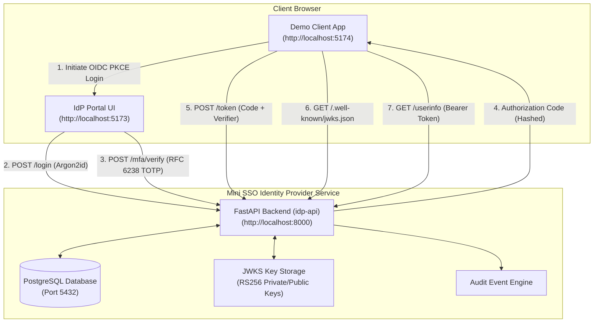

# Mini SSO Login Service

A lightweight, standards-compliant OpenID Connect (OIDC) Identity Provider and Single Sign-On (SSO) service with Time-Based One-Time Password (TOTP) two-factor authentication (2FA), paired with a modern React relying party demonstration application. Built to practice core engineering competencies emphasized in the HENNGE Full-Stack Pathway: API design, cryptographic primitives and authentication security, state management, testing discipline, containerized workflows, and cloud deployment. Start the entire system—PostgreSQL database, FastAPI identity provider, React IdP portal, and React demo client—with a single command: `docker compose up --build`.

> [!NOTE]
> **Educational Project Notice**: This is an educational implementation developed to demonstrate deep first-principles understanding of OpenID Connect, PKCE, RFC 6238 TOTP, and authentication security. It is not intended for production workloads without further operational infrastructure and organizational hardening.

---

## Architecture Overview

The system consists of three decoupled components orchestrated with Docker Compose:

1. **`idp-api`** (Port 8000): Python 3.12+ and FastAPI identity provider with PostgreSQL, SQLAlchemy 2.0, Alembic migrations, Argon2id password hashing, custom RFC 6238 TOTP engine, and RS256 token signing with JWKS.
2. **`idp-ui`** (Port 5173 / Container Port 80): React 18, TypeScript, Vite, and Tailwind CSS portal for authentication, TOTP QR enrollment, and administrator inspection.
3. **`demo-app`** (Port 5174 / Container Port 80): React 18, TypeScript, and Vite relying party application that initiates OIDC PKCE login, exchanges authorization codes, verifies RS256 signatures via JWKS using `jose`, and retrieves user profiles.



---

## Authentication & Authorization Flow

The diagram below details the OpenID Connect Authorization Code Flow with PKCE (S256) and TOTP second-factor verification:


---

## Security Decisions and Architectural Rationale

Every security decision was chosen with specific defensive rationale:

| Decision | Implementation | Security Rationale |
| :--- | :--- | :--- |
| **PKCE (S256 Only)** | Enforced in `app/core/pkce.py`; rejects `method=plain` and requires length 43–128. | In public single-page applications, client secrets cannot be securely stored. PKCE ensures that an intercepted authorization code cannot be redeemed without the browser-held high-entropy `code_verifier`. Rejection of `plain` protects against Downgrade Attacks. |
| **Exact Redirect URI Matching** | Direct string equality against `client.redirect_uris` in database; no regex or wildcards. | Prevents Open Redirector vulnerabilities and parameter tampering where an attacker could coerce the IdP to redirect authorization codes to a third-party server. |
| **Short-Lived, Hashed Codes** | Random 32-byte tokens hashed with SHA-256 before storage; 60-second expiration; `used_at` flag. | If database backups or query logs are ever leaked, stored authorization codes cannot be reversed. Immediate invalidation upon redemption stops code replay attacks. |
| **Argon2id Password Hashing** | `argon2-cffi` configured with RFC 9106 interactive profile ($t=3, m=64\text{MB}, p=4$). | Argon2id is memory-hard and side-channel resistant, providing superior resistance against GPU and ASIC offline brute-force cracking compared to bcrypt or PBKDF2. |
| **Custom RFC 6238 TOTP Engine** | Handcrafted dynamic truncation and counter pack using `hmac` and `hashlib`; tested against RFC 6238 test vectors. | Written from scratch to demonstrate complete mastery of the RFC 4226 / RFC 6238 standard rather than delegating to an opaque third-party library. |
| **Replay Protection via `last_used_step`** | Database tracks the highest time step counter successfully used to authenticate. | Prevents a code from being replayed within the valid 30-second time window. Any attempt to reuse a code at the same or earlier counter step is rejected. |
| **Clock Drift Window ($\pm 1$ step)** | Validates $[T-1, T, T+1]$ steps (30s tolerance window). | Balances user experience across client devices with slight clock synchronization offsets against window expansion risk. |
| **TOTP Secrets Encrypted at Rest** | Authenticated symmetric encryption (`SecretCipher` using AES/Fernet with HKDF-derived keys). | Prevents exposure of user TOTP generator seeds if the SQL database or database dumps are compromised. |
| **RS256 ID Token Signatures** | Asymmetric RSA key pairs (2048-bit) managed in database with unique `kid` and exposed via `/.well-known/jwks.json`. | Relying parties verify ID tokens using public keys without requiring shared secret access, preventing token forgery even if client applications are compromised. |
| **Rate Limiting & Generic Errors** | Sliding-window limiter on failed credentials and TOTP attempts; uniform "Invalid email or password" messages. | Slows down automated credential stuffing and dictionary attacks while preventing user enumeration. |
| **Client IP CIDR Allowlisting** | Optional `allowed_cidrs` per client application enforced during `/authorize`. | Mirrors HENNGE One's access control capabilities, restricting authorization requests to trusted organizational networks (e.g. corporate VPNs or branch offices). |
| **Secure Session Cookies** | `HttpOnly`, `SameSite=Lax`, and `Secure` cookie attributes. | Mitigates Cross-Site Scripting (XSS) token extraction and Cross-Site Request Forgery (CSRF). |
| **Tamper-Resistant Audit Trail** | Dedicated `audit_log` recording timestamp, event type, outcome, user ID, client ID, IP, and user-agent. | Provides full non-repudiation and forensic visibility into authentication successes, failures, and administrative configuration changes. |

---

## Data Model

| Table | Primary Key | Key Columns | Purpose |
| :--- | :--- | :--- | :--- |
| `users` | `id` (UUID) | `email` (unique), `password_hash`, `is_admin`, `created_at` | Core user identity records |
| `totp_credentials` | `user_id` (FK `users.id`) | `secret` (encrypted text), `confirmed_at`, `last_used_step` | TOTP secrets and anti-replay state |
| `clients` | `id` (UUID) | `client_id` (unique), `name`, `redirect_uris` (JSON), `allowed_cidrs` (JSON) | Registered OIDC relying party applications |
| `authorization_codes`| `code_hash` (SHA-256) | `client_id`, `user_id`, `redirect_uri`, `code_challenge`, `nonce`, `expires_at`, `used_at` | Ephemeral single-use authorization codes |
| `sessions` | `id_hash` (SHA-256) | `user_id`, `mfa_verified_at`, `expires_at`, `ip`, `user_agent` | Browser sessions tied to HttpOnly cookies |
| `signing_keys` | `kid` (UUID) | `private_key` (PEM), `public_key` (PEM), `active`, `created_at` | RSA key pairs for RS256 token signing and JWKS |
| `audit_log` | `id` (Autoincrement) | `timestamp`, `user_id`, `client_id`, `event`, `outcome`, `ip`, `user_agent`, `details` | Complete sign-in and security audit trail |

---

## Quickstart: Running with Docker Compose

Ensure Docker and Docker Compose are installed. From the repository root, run:

```bash
docker compose up --build
```

Services will be available at:
- **Demo Client Application**: `http://localhost:5174`
- **IdP Portal / Admin Console**: `http://localhost:5173`
- **IdP API & Swagger Documentation**: `http://localhost:8000/docs`
- **OpenID Discovery Metadata**: `http://localhost:8000/.well-known/openid-configuration`
- **JWKS Endpoint**: `http://localhost:8000/.well-known/jwks.json`

### Seeded Credentials & First Admin User
- The default demo client `demo-client-app` with redirect URI `http://localhost:5174/callback` is seeded automatically on startup.
- The **first user registered** through the web interface automatically receives administrative privileges (`is_admin: true`), providing access to the **Admin Console** at `http://localhost:5173/admin` for audit logs and client management.

---

## Running the Tests

### 1. Backend Tests (pytest with coverage)
The backend test suite covers official RFC 6238 Appendix B test vectors, PKCE challenge calculations, Argon2id verification, RS256 JWT signatures, rate limiting, and full OIDC flow integration:

```bash
cd idp-api
# Using virtual environment:
pytest -v --cov=app --cov-report=term-missing
```

### 2. Frontend Tests (Vitest & React Testing Library)
Run unit and component tests for both frontend applications:

```bash
# IdP UI
cd idp-ui
npm test

# Demo Client Application
cd demo-app
npm test
```

### 3. Code Linting (Ruff)
```bash
cd idp-api
ruff check .
```

### 4. End-to-End Tests (Playwright)
The end-to-end suite registers a fresh account, captures the TOTP secret, computes a genuine RFC 6238 OTP code on-the-fly, completes the OIDC PKCE flow, and verifies token claims in the demo app:

```bash
cd e2e
npm install
npx playwright test
```

---

## What Is Missing on Purpose (and Why)

In alignment with the project plan, the following features were scoped out of the minimum viable implementation to keep the codebase focused, understandable, and testable:

1. **Refresh Tokens and Token Revocation**:
   - *Rationale*: OpenID Connect Core defines the authorization code flow without strictly requiring refresh tokens for public clients. Short-lived access tokens (15 minutes) reduce the window of exposure, and omitting refresh tokens avoids complex storage rotation requirements in browser single-page applications.
2. **Interactive OAuth 2.0 Consent Screen**:
   - *Rationale*: In first-party Single Sign-On environments (such as corporate internal SSO or HENNGE One), user consent is typically pre-granted by corporate policy rather than prompted interactively on every login.
3. **Automated Signing-Key Rotation**:
   - *Rationale*: Key rotation requires maintaining multiple valid keys in the JWKS endpoint simultaneously and managing rollover transition periods. The system is designed key-rotation-ready (keys have a `kid` and are queried dynamically from the database), but automated scheduled rotation was omitted to avoid unnecessary operational complexity in local development.
4. **Account Recovery & Backup Codes**:
   - *Rationale*: Self-service account recovery introduces significant attack surface (email reset token hijack, SMS interception). In corporate SSO, recovery is traditionally handled out-of-band by directory administrators.

---

## Tech Stack Summary

- **Backend**: Python 3.12+, FastAPI, Pydantic v2, SQLAlchemy 2.0, Alembic, PostgreSQL
- **Security & Cryptography**: `argon2-cffi`, `pyjwt[crypto]`, `cryptography`, `segno`, custom RFC 6238 TOTP
- **Frontend**: React 18, TypeScript, Vite, React Router 6, Tailwind CSS, `jose`
- **Testing**: `pytest`, `pytest-cov`, `httpx`, `vitest`, React Testing Library, Playwright
- **DevOps**: Docker, Docker Compose, Nginx, GitHub Actions CI/CD
