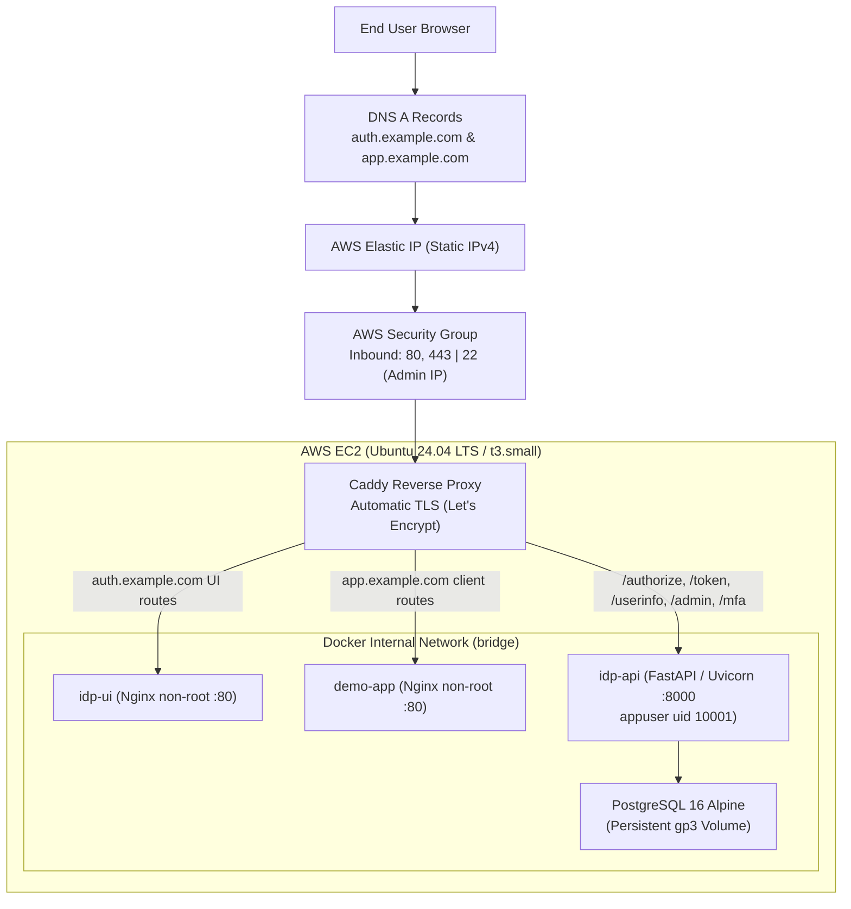

# Mini SSO: AWS Deployment & Operations Guide

This guide documents the production deployment of Mini SSO to Amazon Web Services (AWS) using Terraform for Infrastructure as Code (IaC), Docker Compose for container orchestration, and Caddy for automated Let's Encrypt TLS reverse proxying.

---

## 1. Cloud Architecture



---

## 2. Infrastructure as Code (Terraform)

All AWS infrastructure is declared in `terraform/`:
- **VPC & Subnet**: Dedicated CIDR `10.0.0.0/16` with public subnet `10.0.1.0/24` and internet gateway.
- **Security Group**:
  - `443` (HTTPS): Open to world (`0.0.0.0/0`).
  - `80` (HTTP): Open to world for ACME HTTP-01 challenge and automatic 301 redirect to HTTPS.
  - `22` (SSH): Restricted to `var.admin_cidr` (e.g., your office/home IP).
- **EC2 Instance**: `t3.small` running Ubuntu 24.04 LTS with encrypted 20GB `gp3` root EBS volume.
- **Cloud-Init (`user_data`)**: Automatically provisions Docker Engine, Compose plugin, and `fail2ban` for SSH brute-force defense.
- **Elastic IP (EIP)**: Fixed static IPv4 mapped to the host so DNS records remain permanent across instance reboots.

### Deploying the Infrastructure
```bash
cd terraform
terraform init
terraform plan -out=tfplan
terraform apply tfplan
```

Note the output `public_ip` and `dns_setup_instructions`.

---

## 3. Domain & DNS Configuration

At your DNS registrar (e.g. Route 53, Cloudflare, Namecheap), add two `A` records pointing to your Elastic IP:
```text
auth.yourdomain.com   A   <ELASTIC_IP>
app.yourdomain.com    A   <ELASTIC_IP>
```

---

## 4. Deploying the Applications

1. SSH into the server:
   ```bash
   ssh ubuntu@<ELASTIC_IP>
   ```

2. Clone the repository and configure environment variables:
   ```bash
   cd /opt/mini-sso
   git clone https://github.com/devanshisingal/mini-sso.git .
   cp .env.production.example .env
   ```

3. Populate `.env`:
   - `IDP_DOMAIN=auth.yourdomain.com`
   - `DEMO_DOMAIN=app.yourdomain.com`
   - `ACME_EMAIL=your-email@yourdomain.com`
   - `POSTGRES_PASSWORD=<strong_random_password>`
   - `SECRET_ENCRYPTION_KEY=<32_byte_aes_key>`
   - `ADMIN_API_KEY=<strong_random_key>`

4. Start services with Docker Compose:
   ```bash
   docker compose -f docker-compose.prod.yml up -d --build
   ```

5. Verify health:
   ```bash
   docker compose -f docker-compose.prod.yml ps
   curl -I https://auth.yourdomain.com/health
   ```

---

## 5. Automated TLS with Caddy

Caddy manages TLS lifecycle without external cron jobs or Certbot:
- Automatically issues certificates via Let's Encrypt / ZeroSSL.
- Uses modern cryptographic cipher suites (TLS 1.3, X25519, ChaCha20-Poly1305, AES-256-GCM).
- Automatically renews certificates 30 days before expiration.
- Persists certificates in the `caddy_data` Docker volume.

---

## 6. Backup & Disaster Recovery

### Database Backup Script
Add a daily cron job on the host:
```bash
# /etc/cron.daily/backup-minisso-db
#!/bin/bash
BACKUP_DIR="/var/backups/minisso"
mkdir -p "$BACKUP_DIR"
docker exec mini-sso-prod-db pg_dump -U minisso minisso_prod | gzip > "$BACKUP_DIR/db-$(date +\%F).sql.gz"
find "$BACKUP_DIR" -type f -mtime +14 -delete
```

### Cryptographic Audit Log Export
Admins can verify the SHA-256 chain and export verification proofs:
```bash
curl -H "X-Admin-Key: $ADMIN_API_KEY" https://auth.yourdomain.com/admin/audit-log/verify
```

---

## 7. Cost Breakdown (Monthly)

| Resource | Specification | Estimated Cost (USD) |
|---|---|---|
| **EC2 Instance** | `t3.small` (2 vCPU, 2GB RAM) | ~$15.18 / mo |
| **EBS Storage** | 20GB GP3 (Encrypted) | ~$1.60 / mo |
| **Elastic IP** | 1 Associated IPv4 | Free when attached to running instance |
| **Data Transfer** | Outbound < 10GB | ~$0.90 / mo |
| **Let's Encrypt TLS** | ACME Automated Certificates | Free ($0.00) |
| **Total** | | **~$17.68 / month** (or ~$4.50 with `t3.micro` / Free Tier) |
