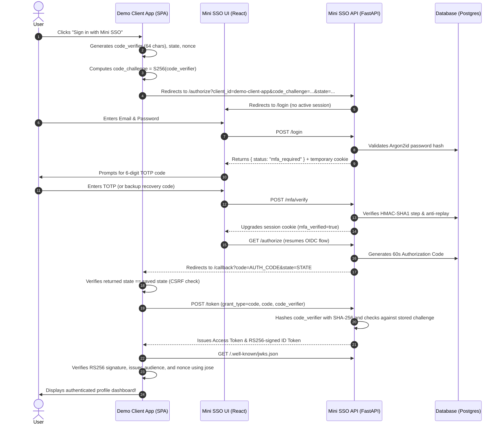

# Mini SSO: 60-Minute Interview Defense & Technical Walkthrough

This document prepares you to defend every engineering decision, architectural trade-off, and security implementation in Mini SSO during an in-depth technical interview (e.g. for the HENNGE Full-Stack Pathway).

---

## 1. High-Level System Narrative

### What is Mini SSO?
Mini SSO is a lightweight, spec-compliant **OpenID Connect (OIDC) Identity Provider** and **Single Sign-On (SSO) login service** paired with a decoupled Single Page Application (SPA) client (`demo-app`).
It demonstrates the entire authentication lifecycle:
1. User registration with **Argon2id** password hashing.
2. Two-Factor Authentication using **first-principles RFC 6238 TOTP** and encrypted secret storage.
3. Emergency authentication via **single-use backup recovery codes**.
4. Single Sign-On authorization flow using **Authorization Code Grant with Mandatory PKCE S256 (RFC 7636)**.
5. Asymmetric token issuance (**RS256**) with dynamic public key distribution (**JWKS, RFC 7517**) and **graceful key rotation**.
6. **Tamper-evident audit logging** using a SHA-256 cryptographic hash chain.

---

## 2. Core Technical Decisions & RFCs

### Q1: Why did you implement RFC 6238 TOTP from scratch instead of using `pyotp`?
> *"The goal was complete algorithmic transparency and defensibility. RFC 6238 computes $T = \lfloor \frac{\text{now} - T_0}{X} \rfloor$ where step $X=30\text{s}$. We pack $T$ as an 8-byte big-endian integer (`struct.pack('>Q', counter)`), compute HMAC-SHA1 over the counter using the base32-decoded secret, extract the 4-bit dynamic truncation offset from the last nibble of the HMAC digest, read the 31-bit big-endian integer, and modulo by $10^6$ to obtain the 6-digit code.*
> *By writing this ourselves, we directly control replay attack prevention (storing `last_used_step` in the database so a code cannot be reused within the 30-second window) and clock drift tolerance ($\pm 1$ step window to tolerate clock skew).*
> *We verified our implementation directly against all RFC 6238 Appendix B test vectors for SHA-1, SHA-256, and SHA-512, and documented the known RFC Errata ID 2866."*

### Q2: Why is PKCE S256 mandatory, and why reject `code_challenge_method=plain`?
> *"In public clients like browser SPAs (`demo-app`), there is no client secret because client-side JavaScript cannot securely store credentials. Without PKCE, an attacker who intercepts the authorization code (e.g. via browser extensions, open redirects, or referrer leakage) could exchange it at `/token` for tokens.*
> *With PKCE S256, the client generates a high-entropy random `code_verifier` (43–128 chars) in browser session storage and sends `code_challenge = BASE64URL(SHA256(code_verifier))` to `/authorize`. When exchanging the code at `/token`, the client provides the raw `code_verifier`. The server hashes it with SHA-256 and compares it against the stored challenge.*
> *If `plain` were allowed, an attacker intercepting the initial URL would see the raw verifier, defeating the purpose. We enforce `S256` strictly."*

### Q3: Why Argon2id instead of bcrypt or PBKDF2?
> *"Argon2id (RFC 9106) won the Password Hashing Competition because it provides memory-hardness. While bcrypt uses only 4 KB of memory and PBKDF2 is CPU-only, our Argon2id configuration requires 64 MiB of RAM per hash. This creates a severe memory bus bottleneck for attackers attempting mass parallel cracking on GPUs or custom ASICs.*
> *Argon2id is a hybrid: it uses data-independent memory addressing for the first pass (defending against cache-timing side-channels) and data-dependent addressing for later passes (defending against GPU cracking).*
> *To prevent Denial of Service attacks where an unauthenticated attacker submits massive 10 MB strings to exhaust CPU/memory, we enforce a 128-character maximum password length at the Pydantic schema validation layer."*

### Q4: How does the tamper-evident audit log work?
> *"Traditional relational databases allow anyone with write access to modify historical audit records. To solve this without the cost or complexity of blockchain, we implemented a linear SHA-256 hash chain.*
> *Every log record stores `prev_hash` (the previous record's hash) and `entry_hash = SHA256(prev_hash | timestamp | user_id | client_id | event | outcome | ip | details)`. The genesis record has `prev_hash = 'GENESIS'`.*
> *The administrative endpoint `GET /admin/audit-log/verify` walks the chain from genesis to head, recomputing every hash and confirming `record[i].prev_hash == record[i-1].entry_hash`. If a single character is modified or an entry is deleted, the entire downstream chain breaks, identifying the exact `tampered_id`."*

### Q5: How does signing key rotation work without breaking active user sessions?
> *"In asymmetric RS256, tokens are signed with the private key and verified with the public key published at `/.well-known/jwks.json`. Each key has a unique `kid` (Key ID).*
> *When an administrator rotates the key via `POST /admin/keys/rotate`, the server marks the old key as retired (`active=False, retired_at=now()`) and generates a new active 2048-bit RSA key pair.*
> *The crucial design detail is that `/.well-known/jwks.json` exports ALL keys (both active and retired). New tokens are signed with the new key, but existing valid tokens in flight continue to verify seamlessly until their expiration without user disruption."*

---

## 3. Real-World Engineering & CI Debugging Story

When asked: *"Tell me about a technical challenge you encountered while setting up this project and how you resolved it."*

> **Answer**:
> *"When setting up GitHub Actions CI, we encountered two subtle configuration challenges:*
> 1. *First, GitHub Actions rejected the workflow with a parser error because we placed `${{ matrix.app }}` inside the top-level `defaults.run.working-directory`. In GitHub Actions, the `defaults` section is evaluated statically before matrix expansion occurs. We fixed this by declaring explicit step working directories and separate dedicated pipeline jobs.*
> 2. *Second, in the frontend test environment (`demo-app`), we encountered a cross-realm `instanceof Uint8Array` error inside the `jose` JWT library when running tests under `jsdom`. In Node.js when `jsdom` creates its own virtual DOM window, `new TextEncoder().encode()` creates an instance of `Uint8Array` in the jsdom realm, but `jose` evaluates `instanceof Uint8Array` against Node's global realm. We solved this cleanly in `demo-app/src/test/setup.ts` by customizing `Uint8Array[Symbol.hasInstance]` to recognize both realms without monkey-patching production code.*
> 3. *Third, during audit log verification, SQLite stripped timezone offsets from datetimes while PostgreSQL preserved them, causing hash verification to fail on SQLite in test runs. We resolved this by creating a deterministic `format_timestamp()` utility that normalizes datetimes to UTC before formatting as RFC 3339 strings."*

---

## 4. End-to-End Authentication Sequence

