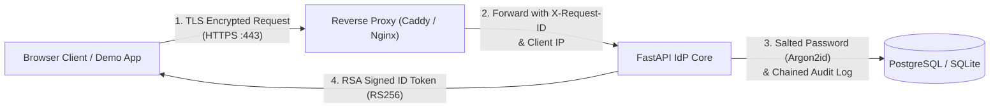

# Mini SSO: Threat Model (STRIDE Methodology)

This document analyzes the security architecture and threat landscape of Mini SSO using Microsoft's **STRIDE** methodology (Spoofing, Tampering, Repudiation, Information Disclosure, Denial of Service, Elevation of Privilege).

---

## 1. System Decomposition & Data Flow

---

## 2. STRIDE Analysis & Defenses

### S — Spoofing Identity
*Threat: An attacker attempts to impersonate a legitimate user or administrative operator.*
- **Password Guessing / Brute-Force**:
  - *Defense*: In-memory sliding-window rate limiting (`RateLimiter`) blocks repeated login attempts after 5 consecutive failures per `(IP, Email)` tuple with exponential backoff.
- **Credential Stuffing**:
  - *Defense*: Mandatory second factor (RFC 6238 TOTP) requires access to the user's physical authenticator device.
- **Authorization Code Interception**:
  - *Defense*: Mandatory PKCE S256 (`code_challenge` / `code_verifier`). An attacker intercepting the code cannot exchange it for tokens at `/token` without the high-entropy 64-character verifier stored in browser session memory.
- **CSRF on SSO Login / Callback**:
  - *Defense*: Demo app generates cryptographic `state` and `nonce` parameters stored in `sessionStorage` and verifies them during `/callback`.

---

### T — Tampering with Data
*Threat: An attacker modifies data in transit or tampers with the database.*
- **Data in Transit**:
  - *Defense*: Enforced TLS 1.3 encryption across all communication via Caddy with HSTS (`Strict-Transport-Security`).
- **ID Token Payload Modification**:
  - *Defense*: ID tokens are cryptographically signed with RS256 using the IdP's private key. Any alteration to claims (`sub`, `aud`, `exp`, `email`) invalidates the signature when verified against `/.well-known/jwks.json`.
- **Redirect URI Hijacking**:
  - *Defense*: Exact string matching enforced against pre-registered redirect URIs in the database. Open redirects, substring matching, path traversal (`../`), and port substitutions are strictly rejected with HTTP 400.
- **Audit Log Falsification**:
  - *Defense*: Every audit entry is cryptographically bound into a SHA-256 hash chain (`prev_hash` $\to$ `entry_hash`). Any database alteration is detected and reported by `GET /admin/audit-log/verify`.

---

### R — Repudiation
*Threat: A user or administrator performs an action and denies having done so.*
- **Authentication & Administrative Actions**:
  - *Defense*: All sign-ins, failures, rate-limiting triggers, MFA enrollments, client registrations, and key rotations write immutable records to the audit log recording `timestamp`, `user_id`, `client_id`, `ip`, `user_agent`, and `details`.
- **Tamper Evidence**:
  - *Defense*: The SHA-256 hash chain prevents selective record deletion. The head hash can be published to external append-only log sinks.

---

### I — Information Disclosure
*Threat: Unauthorized exposure of credentials, tokens, or system state.*
- **User Enumeration**:
  - *Defense*: The `/login` endpoint returns identical HTTP 401 status codes and uniform error messages (`"Invalid email or password"`) whether the email exists or not.
  - *Defense*: Constant-time dummy Argon2 verification is executed on non-existent accounts to eliminate timing side-channels.
- **Session Hijacking**:
  - *Defense*: Session tokens are stored in `HttpOnly`, `SameSite=Lax`, and `Secure` cookies. JavaScript cannot access the session token via `document.cookie` (XSS mitigation).
- **Secrets at Rest**:
  - *Defense*: User passwords are stored as Argon2id hashes (never reversible). TOTP shared secrets are encrypted using AES-GCM / Fernet with a master encryption key.

---

### D — Denial of Service
*Threat: An attacker degrades system availability by exhausting server resources.*
- **Argon2 Resource Exhaustion**:
  - *Defense*: Password length is strictly capped to 128 characters at schema validation, preventing CPU exhaustion from multi-megabyte payloads.
- **TOTP Verification Flooding**:
  - *Defense*: Per-user rate limiting (5 attempts per minute) on `/mfa/verify` and `/mfa/recovery` throttles automated brute-forcing.
- **Database Bloat**:
  - *Defense*: Authorization codes expire in 60 seconds; administrative cleanup sweeps purge expired codes and stale sessions.

---

### E — Elevation of Privilege
*Threat: A normal authenticated user attempts to execute administrative actions.*
- **First-User Admin Takeover Prevention**:
  - *Defense*: Admin privileges are strictly restricted to users matching the configured `ADMIN_EMAIL` (`admin@example.com`). Arbitrary users registering first cannot gain administrative control.
- **Admin Endpoint Protection**:
  - *Defense*: Every route under `/admin` enforces the `require_admin` dependency, validating either a valid session where `user.is_admin == True` or a high-entropy secret `X-Admin-Key` header.
- **Cross-Client Token Replay**:
  - *Defense*: ID tokens explicitly bind the `aud` (Audience) claim to the specific client ID. Client apps verify `aud == client_id` using `jose`, preventing tokens issued for App A from being accepted by App B.
